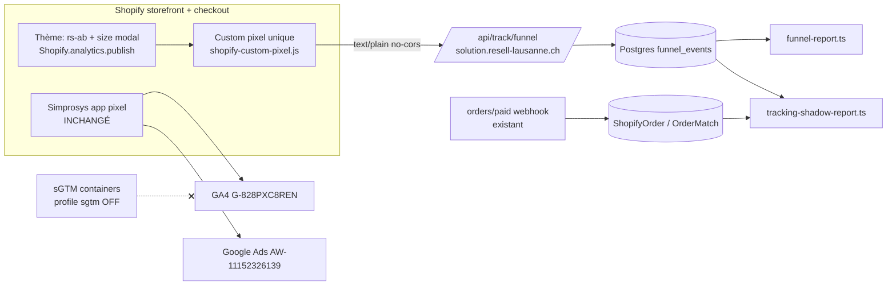

# Tracking plan — resell-lausanne.ch

Statut : **Phase 1 = shadow stack d'observation.** Aucun envoi sortant. Simprosys reste la seule
source de production pour GA4 `G-828PXC8REN` (propriété 375669137), Google Ads `AW-11152326139`,
conversions primaires, enchères, audiences et reporting campagnes. Rien dans ce dossier ne doit
modifier ces éléments avant la gate correspondante (§9), approuvée explicitement par l'utilisateur.

Boutique : sneakers, CH + FR/DE/AT/IT/NL/ES, ~300–350 commandes/mois (354 sur 30 j au 2026-10-14),
AOV ~201–207 CHF, 8 211 clients Shopify.

---

## 1. Principes (non négociables)

1. **Zéro impact production** : aucun tag, conversion, audience ou flux existant n'est modifié en Phase 1.
2. **Brique par brique** : une destination sortante = une gate = une PR qui lève un seul verrou.
3. **Verrou en code** : `tracking/guards.ts` → `OUTBOUND_LOCKED` = `true` pour `ga4_test`,
   `google_ads_secondary`, `meta`, `tiktok`. Les fonctions `send*()` lèvent `OutboundLockedError`
   et n'ont aucun transport HTTP. Les IDs production (GA4, AW, labels, 14 conversion actions) sont
   refusés à vie (`isProductionId`).
4. **Profit = interne** : jamais à la place du revenu, jamais Primary, jamais utilisé en enchères (§6).
5. **Consentement d'abord** : identifiants publicitaires (click ids, email/phone hashés) uniquement
   avec consentement marketing.
6. **Un seul pixel personnalisé** Shopify (`docs/tracking/shopify-custom-pixel.js`).

## 2. Architecture

### Phase 1 (cette PR + #111 + #117)



### Cible (après gates, pas maintenant)

```
custom pixel ──(G3)──> web GTM (sandbox) ──> https://sgtm.resell-lausanne.ch (VPS, #117)
                                                ├─(G3) GA4 TEST property
                                                ├─(G4) Google Ads SECONDARY test actions
                                                └─(G6) Meta CAPI / TikTok Events API
dashboard orders/paid ──(G4/G5)──> Ads click upload SECONDARY (revenue, puis purchase_profit)
dashboard ──(G7)──> Klaviyo (événements taille/prix), Customer Match
cutover Simprosys ──(G8)──> uniquement après comparaison ≥ 4 semaines
```

## 3. Taxonomie des événements (first-party, Phase 1)

Stockés dans `funnel_events` (1 ligne = 1 event Shopify, `event_id` = `event.id` Shopify, unique).

| Event Shopify / thème | Étape funnel | Futur nom GA4 (TEST) | Champs clés |
|---|---|---|---|
| page_viewed | session | page_view | page_path, landing, utm, referrer |
| collection_viewed | liste | view_item_list | collectionId |
| search_submitted | recherche | search | query (100 c.) |
| product_viewed | PDP | view_item | product_id, variant_id, price |
| rs_variant_selected → variant_selected (thème) | clic taille réel | view_item_variant | variantId, SKU, selectedSize, displayedPrice |
| rs_fulfillment_mode_selected → fulfillment_mode_selected (thème) | choix Standard/Express | fulfillment_mode_selected | mode, previousMode, prix affichés |
| rs_cart_item_added → cart_item_added (thème) | confirmation ATC thème | cart_item_added | variante/taille/SKU, mode final, propriétés ligne |
| product_added_to_cart | ATC | add_to_cart | quantity, value |
| upsell_shown / accepted / skipped (thème) | upsell | idem | upsellType, parentProductId |
| flow_cart_opened / flow_checkout_redirect (thème) | flow A/B | idem | source, flow |
| cart_viewed | panier | view_cart | value, itemCount |
| checkout_started | checkout | begin_checkout | checkout_token |
| checkout_contact_info_submitted | contact | add_contact_info | — |
| checkout_address_info_submitted | adresse | add_address_info | country, zip 2 car. |
| checkout_shipping_info_submitted | livraison | add_shipping_info | shipping_method, express |
| payment_info_submitted | paiement | add_payment_info | payment_type, gateway |
| checkout_completed | achat | purchase | **order_id**, value, is_first_order |
| alert_displayed | erreur checkout | checkout_error | alert_type/target/message |
| ab_assigned (thème) | A/B | ab_assigned | experiment, variant |

`cart_item_added` confirme le succès réseau et conserve le mode/propriétés thème absents de
`product_added_to_cart`. Les deux restent distincts; rapports conversion ne les additionnent pas.
`_express_price` et prix affichés sont diagnostiques client: Cart Transform valide le prix via
la métadonnée variante, jamais via cette valeur client.

Commun à chaque event : `client_id` (Shopify), `session_id` (sessionStorage), `ab_variant`
(`experiment:variant,...`), device/os/browser, locale, `webdriver`, `pixel_version`,
`consent_marketing`, `consent_sale_of_data`, click ids (si consentement marketing).

**Item schema (futur, identique au feed Merchant)** : `item_id = shopify_CH_<productId>_<variantId>`,
`item_variant = taille EU`, `item_brand`, `item_name`, `price`, `quantity`, param custom `lane`
(express|standard). Builder : `tracking/contract.ts → feedItemId()`.

Pas de PII stockée : pas d'email/téléphone/nom/adresse (zip 2 caractères, pays). Clés `props`
filtrées (`email|phone|address|name|zip|card`).

## 4. Consentement

Bannière Shopify native (catégories : analytics, marketing, preferences, sale_of_data).

| Shopify customerPrivacy | Phase 1 (first-party) | Futur Consent Mode v2 | Futur Meta/TikTok |
|---|---|---|---|
| analyticsProcessingAllowed | requis pour stocker un event (sinon drop) | analytics_storage | — |
| marketingAllowed | requis pour stocker les click ids | ad_storage, ad_user_data, ad_personalization | requis (sinon rien) |
| saleOfDataAllowed | snapshot seulement | ad_personalization (opt-out US) | requis |
| preferencesProcessingAllowed | — | functionality/personalization_storage | — |

Permission du pixel : « Requis » + « Analytique » seulement. Avec cette permission Shopify ne charge
pas le pixel avant acceptation analytics dans les régions à consentement. Révocation marketing →
click ids effacés du localStorage (`rl_clk`).

## 5. Clés de réconciliation collectées dès la Phase 1

| Clé | Source | Usage futur |
|---|---|---|
| `event_id` | Shopify `event.id` | dédup navigateur ↔ serveur Meta/TikTok (format serveur `purchase_<orderId>`) |
| `order_id` | `checkout.order.id` sur checkout_completed | = `transaction_id` GA4 = `orderId` Ads = `order_id` Meta/TikTok |
| `checkout_token` | checkout | jointure checkout abandonné ↔ commande |
| `client_id` | Shopify pixel | `client_id` GA4 MP (TEST), `external_id` hashé Meta/TikTok |
| `session_id` | pixel | sessions, A/B |
| gclid / gbraid / wbraid | URL landing, 90 j, consent marketing | upload Ads SECONDARY |
| fbclid / ttclid / msclkid | idem | `fbc` Meta, `ttclid` TikTok, Bing |
| `consent_*` | customerPrivacy | filtre d'éligibilité serveur |

## 6. Profit / POAS

**Implémenté** : `tracking/profit.ts` (calcul interne), utilisé uniquement par
`scripts/tracking-shadow-report.ts`. CM1 = CA HT − coût fournisseur ; CM2 = CM1 − frais de paiement
(2.9 % + 0.30) − port sortant (9 CHF) − réserve retours (2 %). Hypothèses surchargeables via
`TRACKING_CM2_*`. Commandes avec coût inconnu (`supplierCost` = 0/absent) → `costComplete=false`,
exclues des stats et **jamais** envoyables.

**Interdit** : remplacer la valeur revenu, marquer une conversion profit Primary, laisser une
campagne optimiser dessus.

**Expérience correcte plus tard (gate G5)** :
1. Créer une action `TEST purchase_profit` (Import → clics, UPLOAD_CLICKS), **Secondary**, hors
   colonne « Conversions » ; valeur = CM2 (bornée à 0, `secondaryProfitConversionValue`).
2. Uploader en observation 4–8 semaines en parallèle de l'action revenu (inchangée).
3. Comparer par campagne/produit ROAS (revenu) vs POAS (CM2 / coût) ; vérifier la couverture
   (≥ 90 % des commandes avec coût complet) et la latence (coût StockX connu après match).
4. Seulement ensuite : test d'enchères contrôlé (campaign experiment 50/50) sur une campagne.

**Est-ce que ça vaut le coup ici ?** Mesure OrderMatch 90 j (964 commandes) :
marge brute pondérée 40 % (avant TVA/port/frais), p10 20 % · p25 29 % · p50 40 % · p75 59 %,
écart-type 33 pts, 30 commandes négatives ; par tranche de panier : <120 CHF 70 %, 120–200 36 %,
200–300 30 %, 300+ 41 %. → **dispersion forte = POAS a un vrai potentiel** (tROAS revenu sur-pousse
les paires 200–300 CHF à marge faible). **Mais pas maintenant** : p90 = 100 % révèle des lignes à coût
0 (accessoires/stock propre non coûtés) qui fausseraient les valeurs, et ~300 conv./mois répartis
sur plusieurs campagnes est juste suffisant pour le Smart Bidding. Verdict : oui en observation
(G5) après nettoyage des coûts ; décision d'enchères seulement si l'écart ROAS/POAS par campagne est
stable sur 4–8 semaines.

## 7. Fusion des données plus tard (sans nourrir les tags actuels)

Réconciliation 100 % hors ligne, lecture seule :

- `funnel_events.order_id` ↔ `ShopifyOrder.shopifyOrderId` (`gid://shopify/Order/<id>`) ↔
  `OrderMatch.shopifyOrderId` (coûts) ↔ Simprosys/GA4 `transaction_id` (= même order id numérique,
  export GA4 ou BigQuery) ↔ Google Ads (rapport conversions par `order_id` via API, lecture).
- Session → commande : `session_id`/`client_id` du checkout_completed → tous les events de la session
  (landing, utm, A/B, click ids).
- Contrôles : couverture (commandes Shopify suivies / total), doublons (`checkout_completed` > 1 par
  commande), part consentement, part click ids, A/B → commandes, CA, CM2 moyen.
- Outil : `npx tsx scripts/tracking-shadow-report.ts --days=14 [--json] [--alert]`.
- Comparaison Simprosys : export GA4 prod (lecture) des `purchase` par `transaction_id` vs
  `ShopifyOrder` → taux de capture Simprosys ; même chose pour le shadow. Aucun write vers GA4/Ads.

## 8. Dédup & cutover (documentation pour plus tard)

- GA4 : dédup sur `transaction_id` ; le shadow va dans une **propriété TEST** séparée → aucun doublon
  possible en prod.
- Google Ads : actions **nouvelles, Secondary**, jamais les 14 existantes ; dédup `order_id` dans
  l'action.
- Meta/TikTok : `event_id` identique navigateur/serveur (`purchase_<orderId>`).
- Cutover Simprosys (G8, hors scope actuel) : seulement après ≥ 4 semaines où le shadow capture
  ≥ Simprosys ± 3 % ; garder le feed Merchant Simprosys ; basculer Primary une seule action à la fois.

## 9. Roadmap à gates (approbation explicite avant chaque destination sortante)

| Gate | Contenu | Sortant ? | Critère d'entrée | Approbation |
|---|---|---|---|---|
| **G0** | Merge #111 + cette PR (migrations additives), installer le pixel unique, `FUNNEL_TRACK_KEY` | Non (DB interne) | revue PR | user |
| **G1** | 2 semaines de collecte : couverture ≥ 90 % des commandes avec consentement analytics, 0 doublon, A/B lisible | Non | `tracking-shadow-report --alert` vert | user |
| **G2** | sGTM up sur VPS (#117), conteneur serveur vide (aucun tag) | Non (aucune destination) | DNS + config string fournis | user |
| **G3** | GA4 **propriété TEST** via web GTM → sGTM | Oui, TEST uniquement | IDs TEST fournis, garde-fous verts, PR qui lève `ga4_test` | user |
| **G4** | Google Ads actions **Secondary** test (revenu) via upload | Oui, Secondary | `validateSecondaryAction` vert, `TRACKING_GOOGLE_ADS_SECONDARY_APPROVED_AT` | user |
| **G5** | `TEST purchase_profit` Secondary, observation 4–8 sem. | Oui, Secondary | coûts complets ≥ 90 % | user |
| **G6** | Meta pixel + CAPI, TikTok pixel + Events API | Oui | IDs + tokens fournis, bannière/politique à jour | user |
| **G7** | Klaviyo onsite + événements taille/prix, Customer Match | Oui | décision §12, consentement email | user |
| **G8** | Cutover Simprosys / changement Primary | Oui, prod | ≥ 4 sem. de parité | user |

## 10. QA & monitoring

- Quotidien : `tracking-shadow-report.ts --alert` (exit 2 si couverture < `TRACKING_SHADOW_MIN_COVERAGE_PCT`, défaut 80 %) — à brancher en timer systemd à G1.
- Volume : events/jour par nom vs moyenne 7 j (funnel-report `--by=day`).
- sGTM : `scripts/sgtm-healthcheck.sh` (#117).
- Debug pixel : Shopify Admin → Customer events → pixel → « Test » ; DB `SELECT event_name, count(*) FROM funnel_events WHERE created_at > now() - interval '1 hour' GROUP BY 1`.

## 11. Vie privée (nLPD suisse + RGPD)

- Base légale Phase 1 : consentement analytics (pixel non chargé sinon). Identifiants pub : consentement marketing.
- Rétention : `funnel_events` 14 mois puis purge (job à ajouter à G1) ; GA4 TEST : 14 mois.
- Politique de confidentialité à compléter (avant G0) : mesure d'audience first-party hébergée
  (Hetzner, UE/DE), données collectées (pages, produits, étapes checkout, pays, appareil, A/B,
  identifiants de clic publicitaires si consentement), durée 14 mois, finalité optimisation du site.
  Avant G3/G6 : ajouter Google Analytics, Google Ads, Meta, TikTok, transferts hors CH/UE (US, DPF).
- Bannière : catégories Shopify inchangées ; vérifier le texte « Marketing » mentionne
  remarketing et mesure publicitaire.

## 12. Remarketing (plan, aucune activation)

- GA4 audiences (sur propriété prod existante, plus tard et seulement si accord) : vu produit+taille,
  abandon panier, abandon checkout, acheteurs, AOV > 300 CHF.
- Customer Match : 651 acheteurs abonnés email (sur 992 abonnés) — seuls les contacts consentants.
- Klaviyo (G7) : abandon checkout/panier, browse avec taille, baisse de prix dans ta taille
  (dashboard → événement depuis repricing StockX), retour en stock dans ta taille, post-achat, winback.
- Changements thème nécessaires **seulement à G6/G7** (aucun en Phase 1) : app embed Klaviyo,
  `klaviyo.push(['track','Size Selected',{ProductID,VariantID,Size,Lane,Price}])` derrière
  `Shopify.customerPrivacy.marketingAllowed()`, attributs panier `_rl_cid`/`_rl_consent` si upload
  serveur. Phase 1 n'en a pas besoin : `checkout_completed` porte déjà `order_id` + `checkout_token`.

### Klaviyo : coût / bénéfice

- Base : 992 abonnés email (651 acheteurs), 6 856 non abonnés, 155 checkouts abandonnés / 30 j.
- Prix : gratuit ≤ 250 profils actifs / 500 envois. Plan Email payant facturé aux profils actifs
  (~1 000–1 500 ici) ≈ 35–45 USD/mois (grille publique ; confirmer sur le curseur klaviyo.com/pricing).
- Gain : 155–180 abandons × 5–10 % = 8–18 commandes × 201 CHF = 1 600–3 600 CHF CA, × 22 % marge
  ≈ **350–800 CHF de contribution/mois**, dont une partie déjà captée par l'email d'abandon natif
  Shopify. Seuil de rentabilité Klaviyo ≈ 1 commande incrémentale/mois.
- Shopify Email : 10 000 envois/mois gratuits, automatisations abandon checkout/panier/browse
  natives, sans flows « taille » ni catalogue variante.
- **Reco** : maintenant → activer/valider les automatisations natives Shopify (abandon checkout, panier)
  car gratuites et hors périmètre Ads. Klaviyo à G7 quand les flows « taille » (prix/stock dans ta
  taille) sont prêts : c'est là que Klaviyo est incrémental.

## 13. Email hashé : effet réel

L'email hashé améliore le matching plateforme (attribution, conversions cross-device, taille des
audiences de remarketing). **À lui seul il ne change pas la valeur rapportée des campagnes.** Il ne
peut influencer les enchères que s'il est rattaché à une **conversion Primary** utilisée dans les
objectifs de campagne. Les événements Secondary / de test n'affectent pas les enchères.

## 14. Actions utilisateur

Phase 1 (maintenant) :
1. Revoir puis merger #111 puis cette PR (migrations additives `funnel_events`) — pas avant validation.
2. VPS `.env` : `FUNNEL_TRACK_KEY=<aléatoire>` (clé d'écriture publique).
3. Shopify Admin → Paramètres → Événements clients → Ajouter un pixel personnalisé « RL shadow » →
   coller `docs/tracking/shopify-custom-pixel.js` (remplacer `__FUNNEL_ENDPOINT__` par
   `https://solution.resell-lausanne.ch/api/track/funnel`, `__FUNNEL_TRACK_KEY__`) → Permission :
   Requis + Analytique → Vente de données : « Ne qualifie pas » → Enregistrer → Connecter.
   Ne **pas** installer `docs/tracking/phase2/*`.
4. Politique de confidentialité : paragraphe §11.
5. Shopify Marketing → Automatisations : vérifier abandon checkout actif.

Préparation (sans activer) :
6. GA4 TEST (G3) : Admin GA4 → Créer → Propriété « RL shadow TEST » (fuseau Zurich, CHF) → flux Web
   `resell-lausanne.ch` → **désactiver** mesure améliorée → noter `G-…` ; rétention 14 mois ; Google
   signals OFF. Ne pas lier à Google Ads.
7. GTM (G2/G3) : compte Resell_lausanne → créer conteneur Web + conteneur Server (provisionnement
   manuel → config string) ; importer `docs/tracking/phase2/gtm-web-container.json` (tags en pause).
8. DNS GoDaddy (G2) : `A sgtm 77.42.74.184`, `A sgtm-preview 77.42.74.184`.
9. Google Ads (G4) : Objectifs → Conversions → Nouvelle → Importer → « Clics » → `TEST purchase (shadow)` →
   Objectif d'action « Secondaire » ; ne pas inclure dans les campagnes. Idem `TEST purchase_profit` (G5).
10. Meta/TikTok (G6) : créer pixel + token CAPI/Events API seulement au moment de G6.
11. Nettoyage : Google tag manager des 6 tags « Shopify Channel App » (GT-…) non chargés — à
    supprimer seulement après vérif qu'aucun n'est la destination liée de Merchant Center/Simprosys.

## 15. Risques

- Couverture pixel < Simprosys (pixel non chargé sans consentement analytics) : normal, mesuré par le rapport.
- `checkout.order.id` absent sur certains moyens de paiement redirigés → fallback `checkout_token`.
- Coûts StockX tardifs (match post-vente) → CM2 provisoire ; ne jamais envoyer de profit incomplet.
- sGTM self-hosted : maintenance image mensuelle ; pas de SLA.
- Dérive : toute PR qui touche `OUTBOUND_LOCKED` ou un ID prod = revue obligatoire.
